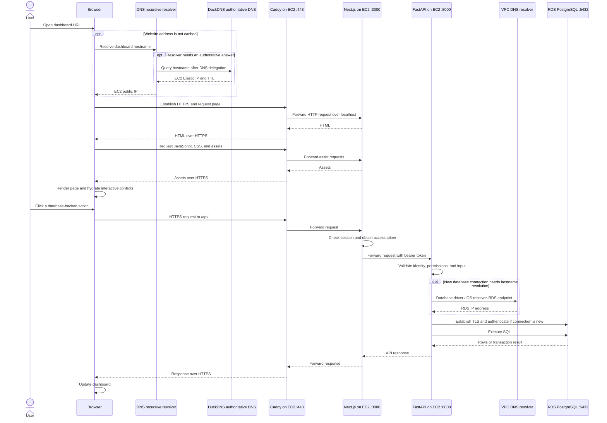

# Dashboard networking: DNS, HTTPS, EC2, and RDS

Last updated: 2026-10-14.

This guide explains the full network flow discussed during the dashboard networking walkthrough: initial page loading, interactive API requests, DNS resolution, Caddy's role, authentication, and database connections.

The application-specific flow below reflects the checked-in hosted demo configuration, not a live inspection of AWS. The [deployment architecture](../deployment/HOSTED_DEPLOYMENT_ARCHITECTURE.md) includes future deployment direction; its illustrative direct Caddy-to-FastAPI route differs from the current implementation, which forwards through Next.js.

## The central distinction

DNS translates a hostname into an IP address. Network routing delivers packets to that address. Caddy receives HTTPS requests, Next.js serves the interface and forwards API requests, FastAPI applies application rules, and RDS executes SQL.

DNS is an address lookup, not a hop through which the website's HTML, JavaScript, API payloads, or SQL must travel.

## Components and responsibilities

| Component | Responsibility |
| --- | --- |
| Browser | Displays HTML, downloads assets, runs JavaScript, and sends HTTP requests. |
| DNS recursive resolver | Finds and caches the DNS answer on behalf of the requesting device. |
| DuckDNS authoritative DNS | Publishes the demo hostname's DNS records. |
| Elastic IP | Stable public IPv4 address assigned to the EC2 deployment. |
| EC2 | Virtual machine running Caddy, Next.js, and FastAPI; provides their operating system and networking. |
| Caddy | Public HTTPS entry point, certificate automation, and reverse proxy. |
| Next.js | Serves the dashboard and handles server-side rendering, authentication integration, and API forwarding. |
| Auth0 | Identity provider used for sign-in and access tokens. |
| FastAPI | Validates API requests, applies authorization and application logic, and invokes storage operations. |
| RDS PostgreSQL | Authenticates database connections and executes relational queries and transactions. |
| VPC | AWS virtual network containing subnets, routing, and the application's AWS network resources. |

## Complete request diagram



The sign-in exchange with Auth0 is a separate flow. The diagram assumes the user already has a valid application session. Database connections and browser connections can be reused, so their setup steps do not happen on every action.

## 1. Resolve the website hostname

For an illustrative URL:

```text
https://therapist-dashboard.duckdns.org/api/transcripts/example
        └──────── hostname ─────────┘└──── request path ─────┘
```

The browser needs an address for the hostname. DNS does not resolve the entire URL and does not examine the request path, query parameters, or request body.

The browser and operating system may already have a usable cached address. Otherwise, the browser uses its configured recursive resolver, usually an internet provider's resolver or a public resolver. Depending on browser settings, DNS may use encrypted DNS rather than the operating system's default resolver.

For a completely uncached lookup, the recursive resolver follows delegation:

```text
Root DNS servers
    → identify the .org nameservers
.org nameservers
    → identify the authoritative nameservers for duckdns.org
DuckDNS authoritative nameservers
    → return the record for therapist-dashboard.duckdns.org
Recursive resolver
    → return the address to the browser
```

The browser normally asks the recursive resolver, rather than directly asking DuckDNS. Cached answers or cached delegations can skip parts of this chain.

An `A` record maps a hostname to an IPv4 address; an `AAAA` record maps it to an IPv6 address. A `CNAME` aliases another hostname that must also be resolved. A record's TTL, or time to live, controls how long it may be cached. DNS changes therefore may take time to reach clients with cached answers. See [Cloudflare's DNS explanation](https://www.cloudflare.com/learning/dns/what-is-dns/?ref=bankless.ghost.io).

The hosted demo workflow updates DuckDNS to point at the deployment's Elastic IP. DNS gives the browser that address; subsequent application traffic goes to EC2, rather than through DuckDNS.

## 2. Establish a connection to EC2

After resolving the hostname, the browser connects to the address on HTTPS port 443. It still identifies the hostname: the hostname matters for TLS certificate verification and HTTP host routing even though packets use IP addresses.

For a typical TCP-based HTTPS connection:

1. TCP establishes the connection.
2. TLS verifies the website's certificate and establishes encryption.
3. HTTP requests and responses travel inside the encrypted connection.

HTTP/3 uses QUIC over UDP instead of TCP; the same distinction between DNS lookup and application traffic still applies.

Packets travel through the device's network, its router, its internet provider, other networks, and AWS's network. AWS routing, including the public subnet's internet gateway path, delivers traffic to EC2 subject to security groups and applicable network ACLs. The Elastic IP is associated with the instance's network interface through AWS networking; the operating system need not have that public address directly assigned to it.

The EC2 security group must allow the relevant public web traffic. Caddy listens for it. EC2 is the machine, while Caddy is the process accepting the web connection.

## 3. Caddy forwards the request to Next.js

The current bootstrap configuration routes application requests to Next.js:

```text
Browser → HTTPS :443 → Caddy → HTTP 127.0.0.1:3000 → Next.js
```

`127.0.0.1` means the same machine. This internal connection stays on EC2 and needs no public DNS lookup.

Caddy terminates TLS: it decrypts the incoming HTTPS request and forwards an HTTP request locally. It keeps the browser-facing connection open and sends the resulting response back over HTTPS. It does not redirect the browser to connect directly to port 3000.

Caddy is responsible for HTTPS and routing, not issuing the user's authorization code or deciding which client records they may access. Next.js, Auth0, and FastAPI perform the identity and application authorization work.

## 4. Next.js provides the page and JavaScript

For the initial page request, Next.js can render content on the server and return HTML with references to JavaScript, CSS, images, and other assets. The browser requests those assets through Caddy as well.

The browser can display the HTML before all interactive JavaScript has loaded. React then hydrates the interactive portions of the page: it connects JavaScript behavior to the rendered interface so controls respond to input.

```text
HTML arrives → browser displays content
JavaScript loads → hydration makes controls interactive
```

Some data can be fetched during server rendering; other data loads after the page opens or in response to an action. Loading a page may create many network requests. Clicking a purely local control may create none.

## 5. Browser JavaScript sends an API request

For example, opening a transcript uses a request shaped like:

```http
GET /api/transcripts/<session-id>?client_id=<client-id>
```

The frontend's relative `/api/...` URL uses the website's existing origin, meaning the same scheme, hostname, and port:

```text
https://therapist-dashboard.duckdns.org/api/transcripts/...
```

The browser may reuse an existing HTTPS connection. It may also have the hostname cached. A button click therefore does not necessarily trigger another DNS lookup, TCP connection, or TLS handshake.

The current general API flow is:

```text
Browser → Caddy → Next.js API route → FastAPI
```

Next.js checks the Auth0 session, obtains an access token, and forwards the request with an `Authorization: Bearer ...` header. It removes the `/api` prefix for the FastAPI route, preserving the query string and forwarding the appropriate method and body.

```text
Browser requests: /api/transcripts/<session-id>?client_id=<client-id>
FastAPI receives: /transcripts/<session-id>?client_id=<client-id>
```

The Next.js-to-FastAPI request uses `API_ORIGIN=http://127.0.0.1:8000` in the hosted bootstrap configuration. Both processes run on EC2, so this hop stays on the machine.

## 6. FastAPI applies the rules and requests database work

FastAPI handles backend behavior: verifying identity, checking organization and client access, validating input, and selecting the required storage operations.

The browser sends HTTP, not SQL. FastAPI's database layer creates and executes SQL. A read returns rows; a write may open a transaction, update records, and commit before the API reports success.

Authentication and authorization are different: authentication establishes who the user is; authorization determines whether that user may perform this operation on these records. DNS, HTTPS, and VPC membership do not grant application permissions.

## 7. Resolve the RDS endpoint and connect to PostgreSQL

RDS provides a database hostname, shaped like:

```text
your-database.<identifier>.us-east-1.rds.amazonaws.com
```

This is the second possible DNS lookup in the full flow. It happens from the backend's environment, independently of the browser's website lookup.

FastAPI's database driver asks to connect to the RDS hostname. The driver uses EC2's operating system networking, which resolves the hostname through the configured DNS resolver, normally the AWS VPC resolver. The driver and operating system then establish the database connection.

EC2 does not act as a separate application that fetches an IP and passes it back to FastAPI. FastAPI is already running on EC2 and uses the machine's networking facilities. The VPC resolver is an AWS-provided service, not a DNS server built into the instance.

```text
FastAPI / database driver
    → OS hostname resolution through VPC DNS
    → RDS IP address
    → PostgreSQL connection on port 5432
    → TLS and database authentication
    → SQL query and results
```

Use the RDS hostname in configuration rather than hardcoding its resolved address; endpoint addresses can change. Existing database connections can be reused, so every query does not need new DNS resolution or a handshake.

Being in the same VPC provides network connectivity when routing permits it. The database security group must allow the application to connect, and database authentication must succeed. The demo Terraform permits port 5432 from the designated application security-group identity and an explicitly allowed operator address range. The connection code uses `sslmode=verify-full` and an RDS CA certificate for encrypted connections with certificate verification. See [AWS's RDS security-group documentation](https://docs.aws.amazon.com/AmazonRDS/latest/UserGuide/Overview.RDSSecurityGroups.html).

The current synthetic demo Terraform sets RDS as publicly accessible, with security-group restrictions. That differs from the private RDS environment described as the later deployment target. Public accessibility does not imply unrestricted access; it also does not require the hosted application to send its database traffic over the public internet.

## 8. Return the result

```text
RDS returns rows or confirms a transaction
    → FastAPI builds the API response
    → Next.js forwards the response
    → Caddy sends it over HTTPS
    → browser JavaScript updates the interface
```

The browser connection and database connection are separate. FastAPI translates database results into an HTTP response. DNS is not involved in passing that response back through the established connections.

Not every action uses RDS alone. Recordings and other artifacts can involve S3; transcription and other processing can involve background jobs. An API may return confirmation that work started, with later requests fetching status or results.

## Why Caddy is useful, and whether it is necessary

Caddy gives the deployment a public HTTPS entry point and forwards requests to the application. It automates obtaining and renewing TLS certificates and redirecting HTTP traffic to HTTPS. The configuration also centralizes response compression and security headers. See [Caddy's automatic HTTPS documentation](https://caddyserver.com/docs/automatic-https).

Caddy itself is optional; public HTTPS still needs to be handled somewhere. Alternatives include Nginx, an AWS Application Load Balancer, or a custom Node.js HTTPS server hosting Next.js. Next.js recommends a reverse proxy when self-hosting. See [Next.js self-hosting guidance](https://nextjs.org/docs/app/guides/self-hosting).

Using a custom HTTPS server would require arranging certificate issuance, renewal, and loading renewed certificates, along with the server's public configuration. These tasks can be automated rather than performed manually, but the deployment owner maintains that automation.

**Caddy is self-hosted software with automatic housekeeping, not a managed hosting service.** You still maintain its installation, updates, configuration, process availability, and EC2 host. A managed service means a provider operates the service for you. Caddy saves you from implementing the HTTPS automation yourself.

## Connection boundaries

| Connection | Protocol / destination port | Scope |
| --- | --- | --- |
| Browser → Caddy | HTTPS / 443; HTTP/3 may use UDP 443 | Public network, encrypted |
| Browser → Caddy HTTP redirect | HTTP / 80 | Public network; redirected to HTTPS |
| Caddy → Next.js | HTTP / 3000 | EC2 loopback |
| Next.js → FastAPI | HTTP / 8000 | EC2 loopback |
| FastAPI → RDS | PostgreSQL with TLS / 5432 | AWS network; controlled by routing and security groups |

Browser requests should use the public HTTPS origin. The browser does not connect to the application's localhost ports or connect directly to RDS.

## Implementation references

- [Frontend API calls](../../frontend/src/lib/api.ts)
- [General Next.js API forwarding route](../../frontend/src/app/api/[...path]/route.ts)
- [Caddy bootstrap and runtime identifiers](../../terraform/demo-app/user-data.sh.tftpl)
- [DuckDNS update workflow](../../.github/workflows/terraform-demo-app.yml)
- [Demo VPC, RDS, and database security groups](../../terraform/demo/main.tf)
- [Database connection configuration](../../database/connection.py)
- [Hosted deployment direction](../deployment/HOSTED_DEPLOYMENT_ARCHITECTURE.md)
- [Local startup guide](../deployment/startup.md)

## Compact mental model

```text
INITIAL PAGE LOAD
Website DNS lookup, if needed
    → Browser → Caddy → Next.js
              ← HTML, JavaScript, CSS ←

DATABASE-BACKED ACTION
Browser JavaScript → Caddy → Next.js → FastAPI → RDS
                  ←        response         ←
                                      ↑
                         RDS DNS lookup, if needed
```

The browser resolves the website hostname. The backend resolves the database hostname. Both use DNS to find addresses; their actual requests travel over separate application connections.
